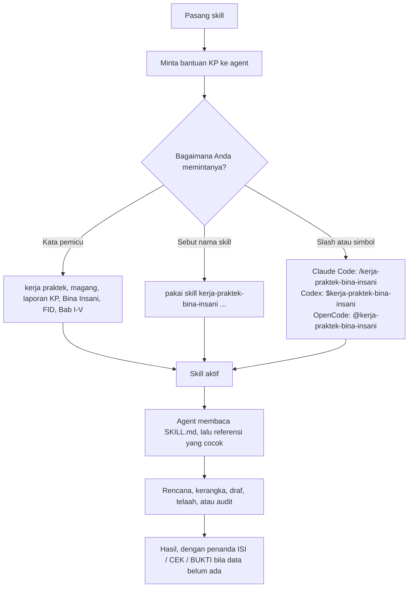

# kp-skill

Skill agent untuk menulis laporan Kerja Praktek di Universitas Bina Insani, disusun dari buku panduan resmi kampus. Formatnya Agent Skills biasa: satu skill adalah satu folder dengan `SKILL.md` di akarnya, jadi agent apa pun yang membaca format itu bisa memakainya.

## Skill

| Skill | Isi |
| --- | --- |
| `kerja-praktek-bina-insani` | Merencanakan, menjalani, dan menulis magang Kerja Praktek beserta laporan KP menurut panduan FID, per program studi (SI, TI, RPL, MI), lengkap dengan prosedur, kerangka, metode analisis (PIECES, SWOT, Karakteristik Informasi), formulir, pemeriksaan akhir, humanizer akademik, dan kebijakan inspeksi dokumen. |

Aturan di dalam skill ini berasal dari *Buku Panduan Kerja Praktek FID Universitas Bina Insani, 2025*. Buku panduan itu dokumen kampus dan tidak disertakan di repo ini. Lihat [docs/rule-sources.md](docs/rule-sources.md) untuk membedakan aturan kampus dan metode milik repo ini.

## Isi skill

| Berkas | Fungsi |
| --- | --- |
| `SKILL.md` | Kewenangan, fakta inti, alur kerja, hierarki bukti, batas revisi, aturan integritas |
| `references/procedure.md` | Penempatan, administrasi, etika, durasi, pembimbingan |
| `references/outlines.md` | Kerangka laporan per program studi |
| `references/content-guide.md` | Isi wajib tiap bagian, metode analisis |
| `references/format.md` | Pengetikan, sampul, penomoran, sitasi, bahasa, daftar pustaka |
| `references/forms.md` | Surat, formulir penilaian, log harian, kartu bimbingan |
| `references/checklist.md` | Pemeriksaan akhir empat lapis |
| `references/humanizer.md` | Humanizer bahasa Indonesia akademik: kategori diagnosis, prosedur penyuntingan, rambu |
| `references/document-inspection.md` | Kebijakan inspeksi Unicode tersembunyi, metadata, dan provenans |
| `references/watermarks-remover.md` | Integrasi opsional [watermarks-remover](https://github.com/guillaumemeyer/watermarks-remover) |

Semua yang dibutuhkan skill ada di dalam folder skill, jadi menyalin folder itu sudah merupakan instalasi lengkap. Integrasi `watermarks-remover` bersifat opsional dan tool-nya dipasang terpisah; lihat `references/watermarks-remover.md`.

## Instalasi

```bash
git clone https://github.com/Nbill27/kp-skill.git
cd kp-skill
```

| Agent | User scope (Linux, macOS) | User scope (Windows) | Project scope |
| --- | --- | --- | --- |
| Claude Code | `~/.claude/skills/` | `%USERPROFILE%\.claude\skills\` | `.claude/skills/` |
| OpenCode | `~/.config/opencode/skills/` | `%USERPROFILE%\.config\opencode\skills\` | `.opencode/skills/` |
| Codex | `~/.agents/skills/` | `%USERPROFILE%\.agents\skills\` | `.agents/skills/` |
| Hermes | `~/.hermes/skills/` | `%USERPROFILE%\.hermes\skills\` | — |
| CodeBuddy | `~/.codebuddy/skills/` | `%USERPROFILE%\.codebuddy\skills\` | `.codebuddy/skills/` |

Jangan ganti nama folder: `name` di frontmatter harus sama dengan nama direktori.

### Linux, macOS, WSL

```bash
./install.sh --claude
./install.sh --all
./install.sh --all --dry-run
./install.sh --claude --uninstall
```

Tanpa flag, targetnya Hermes. `./install.sh --help` mencetak daftar target. Skrip menghapus folder tujuan sebelum menyalin, jadi instalasi ulang tidak menyisakan berkas lama.

### Windows, PowerShell

```powershell
.\install.ps1 -Claude
.\install.ps1 -All
.\install.ps1 -All -DryRun
.\install.ps1 -Claude -Uninstall
.\install.ps1 -Help
```

Pilih satu target, atau pakai `-All`. Dua target sekaligus ditolak. Kalau execution policy memblokir, jalankan `powershell -ExecutionPolicy Bypass -File .\install.ps1 -All`.

### Salin manual

```bash
mkdir -p ~/.claude/skills
cp -r skills/kerja-praktek-bina-insani ~/.claude/skills/
```

Ganti `~/.claude/skills` dengan path mana pun dari tabel di atas.

### Cek hasil instalasi

| Agent | Cara cek |
| --- | --- |
| Claude Code | Jalankan `claude`, lalu `/skills` |
| OpenCode | Muncul sebagai `kerja-praktek-bina-insani`; sebut `@kerja-praktek-bina-insani` di prompt |
| Codex | Jalankan `/skills` di CLI Codex, atau panggil `$kerja-praktek-bina-insani` |
| Hermes | `hermes skills list` |
| CodeBuddy | Lihat daftar skill CodeBuddy |

### Agent lain

`gh skill install` juga bisa, tetapi tidak menebak agent Anda: default-nya project scope dan agent `github-copilot`, jadi sebutkan keduanya.

```bash
gh skill install Nbill27/kp-skill kerja-praktek-bina-insani --agent claude --scope user
```

Ganti `claude` sesuai agent Anda, dan pakai `--scope project` bila skill ingin ikut di-commit bersama repo. Tambahkan `--pin v2.2.0` untuk memasang rilis bertag.

## Pemakaian

Minta agent menulis atau memeriksa laporan KP. Skill aktif saat permintaan cocok: kerja praktek, KP, magang, laporan KP, bimbingan KP, surat keterangan KP, nilai KP, Bina Insani, FID, BAA, nama program studi, atau nama bab seperti Bab I sampai Bab V.

Repo ini tidak punya berkas command terpisah. Skill dipanggil dari apa yang Anda ketik, dan bentuk slash atau simbol disediakan oleh agent-nya sendiri, bukan oleh berkas di repo ini.



Tiga cara memanggilnya:

1. **Kata pemicu, bicara biasa saja.** `tolong buatin outline laporan KP RPL` atau `cek Bab I gue, udah sesuai panduan belum?` Agent melihat kata pemicu di deskripsi skill lalu memuat skill itu sendiri.
2. **Sebut nama skill secara eksplisit.** `pakai skill kerja-praktek-bina-insani, audit laporan KP gue` Pakai cara ini bila permintaan bisa cocok dengan skill lain, atau bila Anda ingin memastikan skill ini yang dipakai.
3. **Slash atau simbol, tergantung agent.** Claude Code: `/kerja-praktek-bina-insani`. Codex: `$kerja-praktek-bina-insani`. OpenCode: `@kerja-praktek-bina-insani`. Hermes dan CodeBuddy: pakai cara 1 atau 2, lalu pastikan skill sudah terpasang lewat `hermes skills list` atau daftar skill CodeBuddy.

Setelah skill aktif, agent membaca `SKILL.md` dulu, lalu hanya referensi yang cocok dengan tugas (misalnya `references/outlines.md` untuk kerangka, `references/format.md` untuk cek format), dan bekerja bab demi bab. Data yang belum ada tidak pernah dikarang: ditandai `[ISI: ...]`, `[CEK: ...]`, `[BUKTI: ...]`, atau `[KONFIRMASI PEMBIMBING: ...]`.

## Memeriksa laporan

Dua skrip disertakan. Keduanya hanya memakai pustaka standar Python, jadi tidak ada yang perlu dipasang.

```bash
python scripts/check_docx.py laporan.docx
python scripts/check_docx.py laporan.docx --json
python scripts/validate_package.py
```

`check_docx.py` memeriksa kertas A4, margin 4/3/4/3 cm, Times New Roman 12, spasi ganda, judul bab 14 pt tebal kapital, dan posisi caption. Skrip juga melaporkan komentar yang belum ditutup, tracked changes, dan catatan editorial yang tertinggal seperti `[Isi tabel ini ...]`. Halaman sampul dan heading bagian awal dilewati karena panduan memberi ukuran tersendiri untuk keduanya. `validate_package.py` memeriksa repo itu sendiri: tata letak, frontmatter, tautan referensi, versi terhadap changelog, dan kesesuaian README.

## Catatan

- Skill tidak mengarang data, responden, sumber, angka, atau hasil. Materi yang belum ada ditandai `[ISI: ...]`, yang belum terverifikasi `[CEK: ...]`, bukti yang belum terlampir `[BUKTI: ...]`, dan yang belum diputuskan `[KONFIRMASI PEMBIMBING: ...]`.
- Skill menolak ghostwriting dan permintaan menyamarkan keluaran AI sebagai tulisan mahasiswa. Humanizer mengejar kualitas tulisan, bukan skor detektor.
- Inspeksi dokumen default-nya memeriksa lalu melapor. Pembersihan karakter tersembunyi atau metadata privat butuh tujuan yang sah dan menulis berkas keluaran terpisah.

## Kontribusi

Baca [CONTRIBUTING.md](CONTRIBUTING.md) sebelum mengubah aturan. Kasus perilaku ada di [tests/prompts/](tests/prompts/), dan [examples/sample-audit.md](examples/sample-audit.md) menunjukkan bentuk keluaran yang diharapkan.

## Lisensi

MIT. Lihat [LICENSE](LICENSE).
