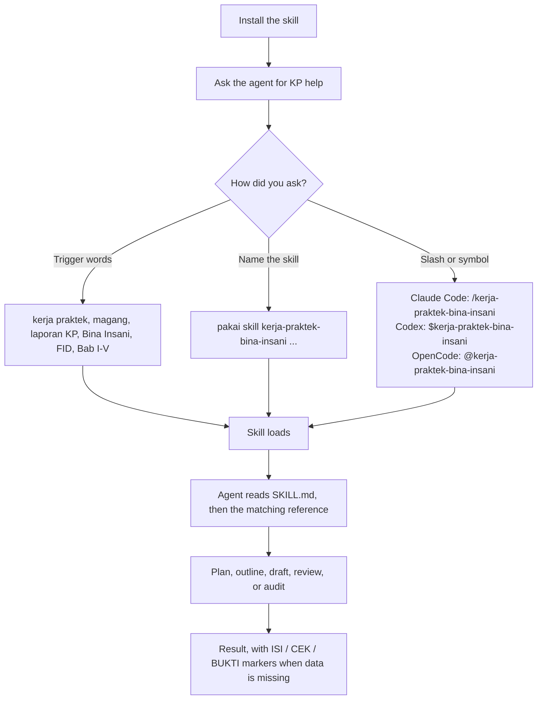

# kp-skill

Agent skill for writing Kerja Praktek reports at Universitas Bina Insani, built from the official campus guide. Plain Agent Skills format: the skill is a folder with a `SKILL.md` at its root, so any agent that reads that format can use it.

## Skills

| Skill | What it does |
| --- | --- |
| `kerja-praktek-bina-insani` | Plans, runs, and writes a Kerja Praktek magang internship and laporan KP under the FID guide, per study program (SI, TI, RPL, MI), with its procedures, outlines, analysis methods (PIECES, SWOT, Information Characteristics), forms, final checks, academic humanizer, and document inspection policy. |

The rules in this skill come from the official guide: *Buku Panduan Kerja Praktek FID Universitas Bina Insani, 2025*. The guide itself is a campus document and is not bundled in this repo. See [docs/rule-sources.md](docs/rule-sources.md) for which rules are campus requirements and which are this repository's own method.

## Inside the skill

| File | Purpose |
| --- | --- |
| `SKILL.md` | Authority, core facts, workflow, evidence hierarchy, revision scope, integrity rules |
| `references/procedure.md` | Placement, administration, ethics, duration, supervision |
| `references/outlines.md` | Report outline per study program |
| `references/content-guide.md` | What each section must contain, analysis methods |
| `references/format.md` | Typing, cover, numbering, citations, language, references |
| `references/forms.md` | Letters, assessment form, daily log, consultation card |
| `references/checklist.md` | Four-layer final check |
| `references/humanizer.md` | Academic Indonesian humanizer: diagnostic categories, editing procedure, guardrails |
| `references/document-inspection.md` | Hidden Unicode, metadata, and provenance inspection policy |
| `references/watermarks-remover.md` | Optional [watermarks-remover](https://github.com/guillaumemeyer/watermarks-remover) integration |
| `scripts/kp-skill.py` | Updater for the installed skill: version, check-update, update, rollback |

Everything the skill needs lives inside the skill folder, so a plain copy of the folder is a complete install. The `watermarks-remover` integration is optional and requires installing that tool separately; see `references/watermarks-remover.md`.

## Install

A skill is a folder with `SKILL.md` at its root, so installing means copying `skills/kerja-praktek-bina-insani/` into a directory your agent scans. Keep the folder name: the frontmatter `name` matches it.

```bash
git clone https://github.com/Nbill27/kp-skill.git
cd kp-skill
```

| Agent | User scope (Linux, macOS) | User scope (Windows) | Project scope |
| --- | --- | --- | --- |
| Claude Code | `~/.claude/skills/` | `%USERPROFILE%\.claude\skills\` | `.claude/skills/` |
| OpenCode | `~/.config/opencode/skills/` | `%USERPROFILE%\.config\opencode\skills\` | `.opencode/skills/` |
| Codex | `~/.agents/skills/` | `%USERPROFILE%\.agents\skills\` | `.agents/skills/` |
| Hermes | `~/.hermes/skills/` | `%USERPROFILE%\.hermes\skills\` | — |
| CodeBuddy | `~/.codebuddy/skills/` | `%USERPROFILE%\.codebuddy\skills\` | `.codebuddy/skills/` |

User scope makes the skill available in every project; project scope commits it with the repository so the whole team gets it. Pick either, or both.

### Installer script (Linux, macOS, WSL)

`install.sh` performs the copy for you. Run it from the repository root.

```bash
./install.sh --claude       # one agent
./install.sh --opencode
./install.sh --codex
./install.sh --hermes
./install.sh --codebuddy
./install.sh --all          # every agent above
```

Two more options:

```bash
./install.sh --all --dry-run    # print the destinations, write nothing
./install.sh --claude --uninstall
```

With no flag it installs into Hermes. `./install.sh --help` prints the targets. The script deletes the destination folder before copying, so a reinstall cannot leave a file behind that no longer ships. It never touches anything outside the agent skills directories listed above.

### Installer script (Windows, PowerShell)

```powershell
.\install.ps1 -Claude
.\install.ps1 -OpenCode
.\install.ps1 -Codex
.\install.ps1 -Hermes
.\install.ps1 -CodeBuddy
.\install.ps1 -All
.\install.ps1 -All -DryRun
.\install.ps1 -Claude -Uninstall
.\install.ps1 -Help
```

Pick exactly one target, or use `-All`. Passing two targets is an error. On Windows PowerShell 5.1 the execution policy may block the script; run `powershell -ExecutionPolicy Bypass -File .\install.ps1 -All` if it does.

### Manual copy

If you would rather not run a script, copy the folder yourself. The command differs only in the destination:

```bash
mkdir -p ~/.claude/skills
cp -r skills/kerja-praktek-bina-insani ~/.claude/skills/
```

Swap `~/.claude/skills` for any path in the table above.

### Verify the install

| Agent | Check |
| --- | --- |
| Claude Code | Start `claude`, run `/skills`, confirm `kerja-praktek-bina-insani` is listed |
| OpenCode | The skill is advertised as `kerja-praktek-bina-insani`; mention `@kerja-praktek-bina-insani` in a prompt |
| Codex | Run `/skills` in the Codex CLI, or invoke `$kerja-praktek-bina-insani` |
| Hermes | `hermes skills list` |
| CodeBuddy | Check the CodeBuddy skills list |

OpenCode also scans `~/.claude/skills` and `~/.agents/skills`, so an install for Claude Code or Codex is picked up without a second copy.

### Other agents

Copy the skill folder into the agent skills directory, keeping the folder name. `gh skill install` works too, but it does not guess your agent: the defaults are project scope and the `github-copilot` agent, so pass both explicitly.

```bash
gh skill install Nbill27/kp-skill kerja-praktek-bina-insani --agent claude --scope user
```

Replace `claude` with `opencode`, `codex`, or the agent you use, and use `--scope project` to commit the skill with the repository instead. Add `--pin v2.2.0` to install the tagged release instead of the current default branch.

## Updating

There is no auto-update. Installing copies the skill folder into the agent's skills directory, so the agent reads that copy, not this repository. Pulling the latest repo alone does not change an installed copy.

To update an installed skill:

```bash
cd kp-skill
git pull
./install.sh --all
```

On Windows, use `.\install.ps1 -All` instead. Replace `--all` with one agent flag (for example `--claude`) to update only that agent.

The installer removes the destination folder before copying, so a reinstall cannot leave behind a file that no longer ships in the new version. A plain `cp -r` does not do this: it merges into the old folder and leaves stale files in place, so use the installer for updates.

If you installed with `gh skill install`, run the same command again to install the latest version. If you installed into a project, copy the updated folder into that project's agent skills directory again and commit the updated copy.

### Updating with the updater

From v2.2.1 on, the installed skill folder ships its own updater at `scripts/kp-skill.py` (standard library only, no Git needed). Run it from the installed skill folder, for example `~/.claude/skills/kerja-praktek-bina-insani/`:

```bash
python scripts/kp-skill.py version
python scripts/kp-skill.py check-update
python scripts/kp-skill.py update
python scripts/kp-skill.py rollback
```

`check-update` only compares the installed version with the latest GitHub Release and changes nothing. `update` downloads that release, extracts it safely, runs the package validator from the extracted release, backs the current installation up outside the skill folder, and only then replaces it; if the replacement fails, the backup is restored. `rollback` restores the latest backup. Add `--yes` to skip the confirmation prompt, and `--to 2.3.0` to update to a specific version instead of the latest. There is no automatic update. The updater needs Python 3.10 or newer; it does not need Git or a package manager. SHA-256 is only claimed as a cryptographic check when the release carries a `SHA256SUMS.txt` asset with a matching entry and the hash matches; otherwise the update is validated by safe extraction plus the package validator.

Bootstrap: a v2.2.0 installation has no updater yet, so install v2.2.1 once with the installer above first. After that, the updater handles later versions. Backups are kept in the user cache directory (`~/.cache/kp-skill/backups` on Linux and macOS, `%LOCALAPPDATA%\kp-skill\backups` on Windows), not inside the skill folder.

After reinstalling, start a new agent session. A running session may still use the old copy. Then check the installed version matches the repo:

```bash
grep "^Version" ~/.claude/skills/kerja-praktek-bina-insani/SKILL.md
```

Compare it with the newest entry in [CHANGELOG.md](CHANGELOG.md). There is no update notification: check the changelog or the release tags on GitHub when you want to know if a new version exists.

## Use

Ask the agent to write or check a laporan KP. The skill loads when the request matches: kerja praktek, KP, magang, laporan KP, bimbingan KP, surat keterangan KP, nilai KP, Bina Insani, FID, BAA, a study program name, or a chapter name such as Bab I through Bab V.

There is no separate command file in this repo. The skill is invoked by what you type, and the slash or symbol form is provided by the agent itself, not by a file here.



Three ways to call it:

1. **Trigger words, just talk normally.** `tolong buatin outline laporan KP RPL` or `cek Bab I gue, udah sesuai panduan belum?` The agent sees a trigger word in the skill description and loads the skill on its own.
2. **Name the skill explicitly.** `pakai skill kerja-praktek-bina-insani, audit laporan KP gue` Use this when the request could match another skill, or when you want to be sure this one is used.
3. **Slash or symbol, per agent.** Claude Code: `/kerja-praktek-bina-insani`. Codex: `$kerja-praktek-bina-insani`. OpenCode: `@kerja-praktek-bina-insani`. Hermes and CodeBuddy: use way 1 or 2, then confirm with `hermes skills list` or the CodeBuddy skills list that the skill is installed.

After the skill loads, the agent reads `SKILL.md` first, then only the reference that fits the task (for example `references/outlines.md` for an outline, `references/format.md` for a format check), and works chapter by chapter. Missing data is never invented: it is marked `[ISI: ...]`, `[CEK: ...]`, `[BUKTI: ...]`, or `[KONFIRMASI PEMBIMBING: ...]`.

## Check your report

Two scripts ship with the repository. Both use the Python standard library only, so there is nothing to install.

`scripts/check_docx.py` reads a `.docx` and checks the rules in `references/format.md`: A4 paper, 4/3/4/3 cm margins, Times New Roman 12, double spacing, 14 pt bold uppercase chapter titles, and caption placement. It also reports unresolved comments, tracked changes, and leftover editorial notes such as `[Isi tabel ini ...]`. The cover page and front-matter headings are skipped because the guide gives them their own sizes.

```bash
python scripts/check_docx.py laporan.docx
python scripts/check_docx.py laporan.docx --json
python scripts/check_docx.py laporan.docx --fail-on high
```

`scripts/validate_package.py` checks the repository itself: layout, frontmatter, reference links, version against the changelog, and that the README matches what ships.

```bash
python scripts/validate_package.py
```

## Notes

- The skill never invents data, respondents, sources, numbers, or results. Missing material is marked `[ISI: ...]`, unverified material `[CEK: ...]`, unattached evidence `[BUKTI: ...]`, and undecided items `[KONFIRMASI PEMBIMBING: ...]`.
- The skill refuses ghostwriting and requests to disguise AI output as the student's own writing. The humanizer targets writing quality; it does not target detector scores.
- Document inspection defaults to inspect-and-report. Cleaning hidden characters or private metadata requires an authorized purpose and writes a separate output file.

## Contributing

Read [CONTRIBUTING.md](CONTRIBUTING.md) before changing a rule. Behaviour cases live in [tests/prompts/](tests/prompts/), and [examples/sample-audit.md](examples/sample-audit.md) shows the expected output shape.

## Changelog

See [CHANGELOG.md](CHANGELOG.md).

## License

MIT. See [LICENSE](LICENSE).
